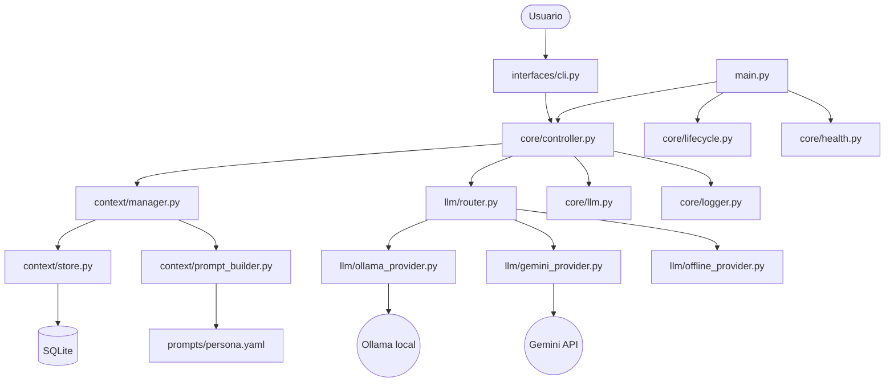

# Arquitectura de A.E.T.H.E.L.

**Versión:** 0.3.0 | **Estado:** Fase 04, núcleo conversacional

## 1. Alcance

Este documento describe la arquitectura **implementada** en la Fase 04. Los
componentes de fases posteriores se recogen al final como planificados, sin
presentarlos como funcionalidad disponible.

El objetivo actual es un asistente de consola con personalidad configurable,
memoria conversacional y proveedor de IA intercambiable. Todavía no ejecuta
herramientas del sistema, no tiene voz y no dispone de memoria a largo plazo.

## 2. Flujo actual



## 3. Componentes actuales

### Entrada y orquestación

- `src/interfaces/cli.py`: lee mensajes, procesa comandos (`/modelo`,
  `/estado`, `/memoria`, `/limpiar`) y muestra la respuesta con su
  `request_id`.
- `src/core/controller.py`: valida la entrada, resuelve `ping` localmente,
  comprueba el presupuesto, construye el prompt, llama al router y guarda los
  turnos.
- `src/core/llm.py`: contrato `ProveedorLLM`, respuesta estructurada y
  `GestorPresupuesto`.

### Contexto y personalidad

- `src/context/manager.py`: ventana de mensajes en RAM con respaldo SQLite,
  compactación y resumen.
- `src/context/store.py`: esquema SQLite, sesiones, mensajes, retención y
  cifrado Fernet opcional.
- `src/context/prompt_builder.py`: carga y valida `prompts/persona.yaml`.
- `src/context/sanitizer.py`: elimina secretos, correos y rutas privadas antes
  de persistir o enviar contexto.

### Proveedores

- `src/llm/router.py`: prueba proveedores en el orden configurado y conserva
  el último proveedor, modelo y latencia.
- `src/llm/ollama_provider.py`: adaptador local con `think=false` por defecto,
  límites de contexto y salida, y `keep_alive`.
- `src/llm/gemini_provider.py` y `src/infrastructure/gemini_client.py`:
  adaptador cloud con reintentos y fallback de modelos.
- `src/llm/offline_provider.py`: último recurso determinista sin red.

### Arranque y operación

- `src/main.py`: composition root. Valida configuración, comprueba salud,
  construye router, presupuesto, contexto y CLI.
- `src/core/lifecycle.py`: candado de instancia, señales y apagado ordenado.
- `src/core/health.py`: comprueba almacenamiento, logs y clave de IA.
- `src/core/logger.py`: logging con `request_id` y censura básica.

## 4. Persistencia actual

```text
conversation_sessions
├── id TEXT PRIMARY KEY
├── started_at TEXT
├── last_activity_at TEXT
├── summary TEXT
└── archived INTEGER

conversation_messages
├── id INTEGER PRIMARY KEY
├── session_id TEXT REFERENCES conversation_sessions(id)
├── role TEXT
├── content TEXT
└── created_at TEXT
```

La retención elimina primero los mensajes de las sesiones archivadas y después
las sesiones. Las bases nuevas incluyen `ON DELETE CASCADE`; las antiguas
siguen funcionando por la limpieza explícita.

## 5. Componentes planificados

Los siguientes módulos existen como marcadores de posición y **no están
implementados**:

- `src/core/dispatcher.py`: dispatcher de eventos.
- `src/ai/engine.py`, `src/ai/prompts.py`: motor y plantillas de IA.
- `src/memory/manager.py`, `src/memory/models.py`: memoria a largo plazo y
  diario personal.
- `src/tools/executor.py`, `src/tools/registry.py`: herramientas con permisos
  y auditoría.
- `src/security/` y `src/automation/`: no existen todavía.

La Fase 05 deberá diseñar la tabla de usuarios y la relación con sesiones antes
de implementar el diario. No se ha iniciado esa fase en este repositorio.
