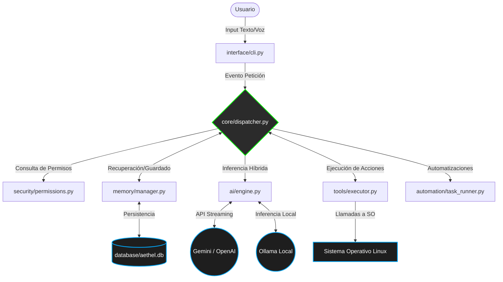

# Documentación de Arquitectura: A.E.T.H.E.L.

**Versión:** 0.2.0 | **Estado:** En Desarrollo (Fase 02)

## 1. Visión General

A.E.T.H.E.L. es un asistente virtual modular y backend-driven diseñado bajo los principios de la **Arquitectura Limpia (Clean Architecture)** y el patrón **Event-Driven (Basado en Eventos)**. El objetivo principal es mantener un acoplamiento nulo entre la lógica de inferencia (IA), las herramientas de ejecución local y la interfaz de usuario.

---

## 2. Diagrama de Componentes Principales

El sistema opera a través de un orquestador central (`dispatcher.py`) que enruta las peticiones entre los módulos aislados.

