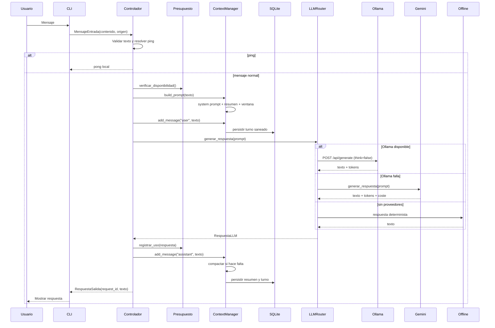

# Flujo de datos de A.E.T.H.E.L.

**Versión:** 0.3.0 | **Fase:** 04

## 1. Flujo real de una petición



## 2. Orden de proveedores

El orden se controla con `LLM_PROVIDER_ORDER`. El valor por defecto es:

```dotenv
LLM_PROVIDER_ORDER=ollama,gemini,offline
```

- `ollama`: proveedor local principal. No requiere API key ni envía datos a la
  nube. Se recomienda `OLLAMA_THINK=false` para modelos Qwen3.
- `gemini`: respaldo cloud si hay `AI_API_KEY` y el proveedor está en el orden.
- `offline`: último recurso determinista, sin red.

## 3. Presupuesto, latencia y coste

`GestorPresupuesto` acumula tokens y coste durante la ejecución. El límite se
lee de `LLM_BUDGET_USD` y se comprueba antes de cada petición. Ollama registra
tokens y coste cero; Gemini calcula el coste estimado según sus tarifas.

`LLMRouter` conserva el último proveedor, modelo y latencia. La CLI los expone
con `/modelo` y `/estado`. Estos datos son la base para medir la evaluación
04.5.

## 4. Contexto y retención

La ventana activa se guarda en RAM y se persiste en SQLite. Cuando supera el
límite, se resume una parte y se conserva el resumen junto con los mensajes
recientes. La retención elimina sesiones archivadas antiguas y sus mensajes.

## 5. Flujo futuro (no implementado)

La integración de herramientas, la validación de permisos, la ejecución local,
la voz, la memoria a largo plazo y el streaming de tokens pertenecen a fases
posteriores. No deben asumirse disponibles a partir de este documento.
