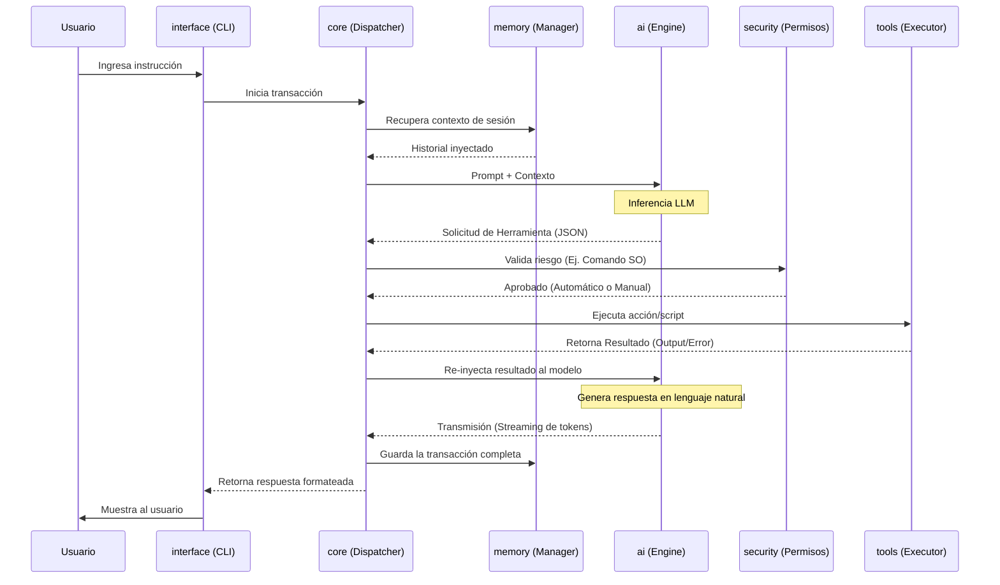

# Flujo de Datos y Ciclo de Vida: A.E.T.H.E.L.

**Versión:** 0.2.0 | **Fase:** 02

## 1. Ciclo de Vida de una Petición (Secuencia)

El siguiente diagrama detalla cómo viaja la información desde la entrada del usuario hasta la respuesta final, incluyendo la validación de seguridad y la ejecución de herramientas locales (Tool Calling).

